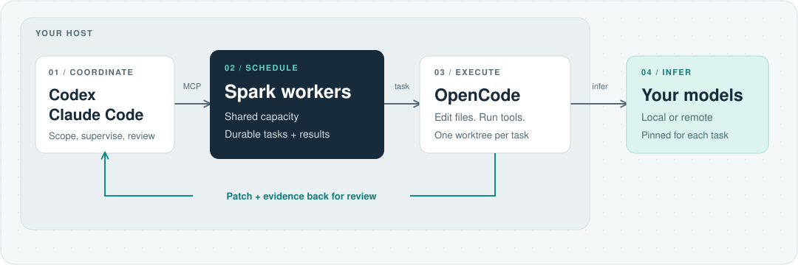

# Spark workers

Your main agent has company.

Spark workers lets Codex and Claude Code hand focused jobs to your own coding models. Send a worker after a stubborn test, a small bug, or a second opinion on a module while your main agent keeps moving. Each task gets its own Git worktree and comes back with a patch you can inspect.



One shared MCP (Model Context Protocol) scheduler keeps the clients from overbooking your models. OpenCode handles the actual editing and command execution on the host; inference can happen on another machine.

- **Give each job some room.** Separate worktrees keep worker edits out of your current checkout.
- **Pick the model and keep it.** Tasks stay on the selected model, with shared concurrency limits across clients.
- **Keep the receipts.** Status, patches, and results survive scheduler restarts.
- **Review before it lands.** Independent checks and explicit feedback come before cleanup. Integration stays with the coordinator.

## Requirements

- macOS or Linux, Python 3.12+, Git with a configured author, and [uv](https://docs.astral.sh/uv/getting-started/installation/).
- [OpenCode 2](https://opencode.ai/v2/docs/) installed and configured with your model provider. The adapter is tested against **2.1.4** and does not support the version-1 interface.
- A model endpoint with a `/models` inventory and a model suitable for coding and tool use.
- Codex or Claude Code as the coordinating client.

## Quick start

Run these commands from this repository's root.

### 1. Configure a backend

```sh
uv sync --frozen
cp -n config.example.json config.json
```

Edit `config.json`. For a single model server, use:

```json
{
  "port": 18990,
  "poll_seconds": 5,
  "health_failure_threshold": 2,
  "task_timeout_seconds": 1200,
  "max_assistant_turns": 24,
  "backends": {
    "primary": {
      "base_url": "http://127.0.0.1:18000/v1",
      "provider": "primary",
      "model": "qwen-model",
      "capacity": 2
    }
  }
}
```

Replace `base_url`, `provider`, and `model` with your actual values. Configure the matching provider in [OpenCode](https://opencode.ai/v2/docs/providers/#custom) too: Spark workers checks the endpoint's model inventory, but OpenCode owns inference configuration and credentials. The scheduler does not create OpenCode providers. For this example, OpenCode must know provider `primary` and model `qwen-model`, pointing to the same endpoint. The endpoint's `/models` response must list that exact model ID.

[config.example.json](config.example.json) also shows two backends with conditional capacity: primary allows two tasks, or three while secondary is unavailable. A busy backend is still available. Limits cover this scheduler's tasks, not other users of the model servers.

### 2. Start the services

```sh
opencode service start
uv run spark-workers --config config.json
```

Keep the scheduler running. It discovers OpenCode's URL and credentials through `~/.local/state/opencode/service.json`, so run both services as the same user. Use one shared scheduler for your clients.

In another terminal, check that the configured backend is available:

```sh
curl -s http://127.0.0.1:18990/health
```

### 3. Connect your client

For Codex:

```sh
codex mcp add spark-workers --url http://127.0.0.1:18990/mcp
mkdir -p "$HOME/.codex/skills"
ln -s "$PWD/skill" "$HOME/.codex/skills/spark-workers"
```

For Claude Code:

```sh
claude mcp add --scope user --transport http spark-workers http://127.0.0.1:18990/mcp
mkdir -p "$HOME/.claude/skills"
ln -s "$PWD/skill" "$HOME/.claude/skills/spark-workers"
```

Reconnect the client after installation. The [skill](skill/SKILL.md) teaches the coordinator when to delegate, how to supervise permissions, and how to review and clean up results. Keep the repository at this location while using the symbolic link.

### 4. Delegate a first task

Open a Git repository in your client and ask, for example:

> Use Spark workers to investigate the parser tests. Delegate a read-only review of `tests/test_parser.py` to an available backend and ask for missing edge cases. Do not change files. While it runs, inspect `src/parser.py` yourself, then compare the findings.

Replace the paths with files in your repository. The coordinator checks `workers_status`, resolves the current commit, and submits an assignment with a goal, relevant files, allowed edit paths, and acceptance criteria. For an implementation task, specify which files the worker may change. Review the returned patch before integrating it.

## From assignment to reviewed patch

| Tool | Purpose |
| --- | --- |
| `workers_status` | Check backend availability and free slots. |
| `delegate` | Start a bounded task with an explicit base commit and edit scope. |
| `worker_wait` / `worker_result` | Wait for progress or retrieve the summary, permissions, and patch paths. |
| `worker_permission` | Approve or reject one pending command after inspecting it. |
| `worker_verify` | Run independent checks against the worker's retained worktree. |
| `worker_followup` | Request corrections in the same task. |
| `worker_feedback` / `worker_cleanup` | Record the review outcome, then remove the disposable worktree. |
| `workers_list` / `workers_metrics` | Find stored tasks and inspect recorded usage and outcomes. |
| `worker_cancel` | Stop a task while retaining partial changes and evidence. |

Reuse a request ID when retrying the same start or follow-up; use a new ID for a new request. `worker_wait` supports any/all waits of up to 30 seconds and returns early for approvals. `worker_wait` and `worker_result` report the latest checkpoint, tool activity, and configured turn and time budgets. Each run has one additional assistant turn for a final response. If the scheduler observes tool use beyond the turn budget, it interrupts the session; polling means that tool may already have started. Time spent waiting for command approval does not count against the run's time budget. `workers_list` supports status, repository, and creation-time filters with pagination.

Completion means the worker has finished, not that its patch has passed independent checks or review. `worker_verify` runs up to three approved command argument lists with a shared 30-second budget, without a shell or model. Longer checks belong in the coordinating agent. Failed checks block acceptance. Integrate patches one at a time, record feedback, then clean up. Cleanup refuses changes made after the last export.

Follow-ups preserve earlier summaries, patches, and evidence; `worker_result` can select a historical `run`. Patches remain cumulative from the original task input, and token usage is cumulative within the session. A stopped failed task can be continued with an explicit `recovery_reason`; its previous failure remains archived. Each explicit follow-up gets a fresh configured run budget while preserving the original scope and model. Recovery cannot override denied permissions.

If a budget stops a task before its final answer, inspect its `progress` and local `evidence` path. Keep the worktree until a follow-up has summarized or continued the work, or the result is rejected.

## The boundaries

- **Local trusted use.** The scheduler binds to `127.0.0.1` with browser-origin checks and no separate authentication. Any local process that can reach it can start tasks and approve shell commands. Do not run it on a shared machine. Approved commands execute on the host without a sandbox; Git worktrees isolate files, not networks or services.
- **Working-copy snapshots.** With `include_working_tree=true`, the base commit must equal current `HEAD`. Tracked and non-ignored untracked files are included without changing the caller's index. Ignored dependencies and data are omitted; repositories with submodules are rejected.
- **Conservative recovery.** Cancellation retains capacity until execution has stopped and queued input is removed. Uncertain prompt submission retains capacity across restarts rather than risking duplicate execution. A verification interrupted by a service crash blocks continuation and cleanup until an operator reconciles its logs and process.
- **Local evidence.** Task state, patches, and full responses stay in `.state/jobs/<task-id>/`; service logs rotate in `.state/service.log`. `config.json` and `.state/` are excluded from Git and package builds.
- **Measured usage.** Missing token usage remains unknown. Coordinator token counts require explicit measured input; the scheduler does not infer token savings.

## Development

```sh
uv run ruff check .
uv run python -m unittest discover -s tests -v
uv build
```

These tests require no model credentials. To exercise a live backend, start both services and run:

```sh
uv run python -u tests/smoke.py --backend primary
```

The smoke test creates a temporary repository, requests a real model edit, approves a bounded test command, checks the resulting patch, and cleans up its worktree. It uses inference on the selected backend.

To verify that OpenCode denies a worker session's `worker_permission` MCP action, start the OpenCode service and run:

```sh
uv run python -u tests/check_worker_mcp_permissions.py
```

This check creates and deletes a temporary OpenCode session, makes no model request, and does not call the MCP tool. An explicit allow rule acts as a positive control so an unrecognized or misspelled action name cannot pass merely because of the default deny rule.

## License

[MIT](LICENSE), copyright 2026 David Schulmeister.
